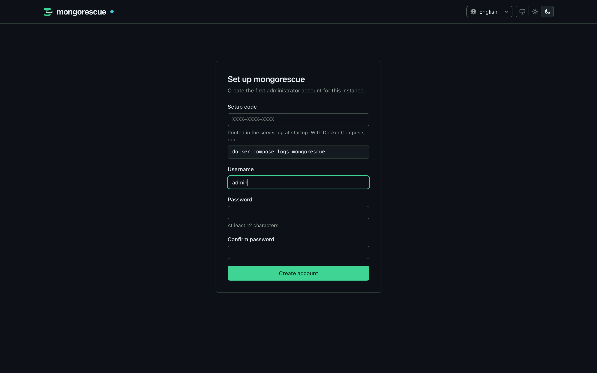
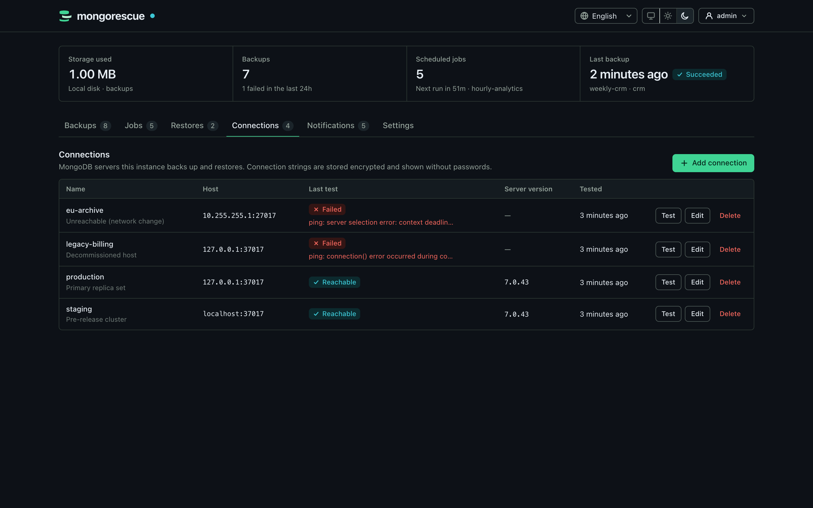
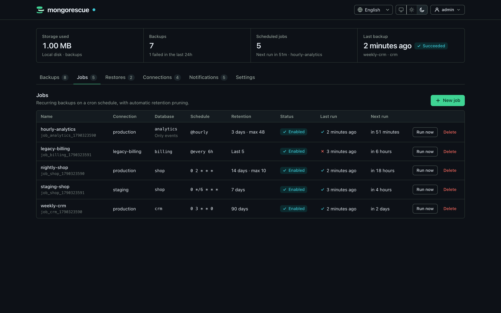
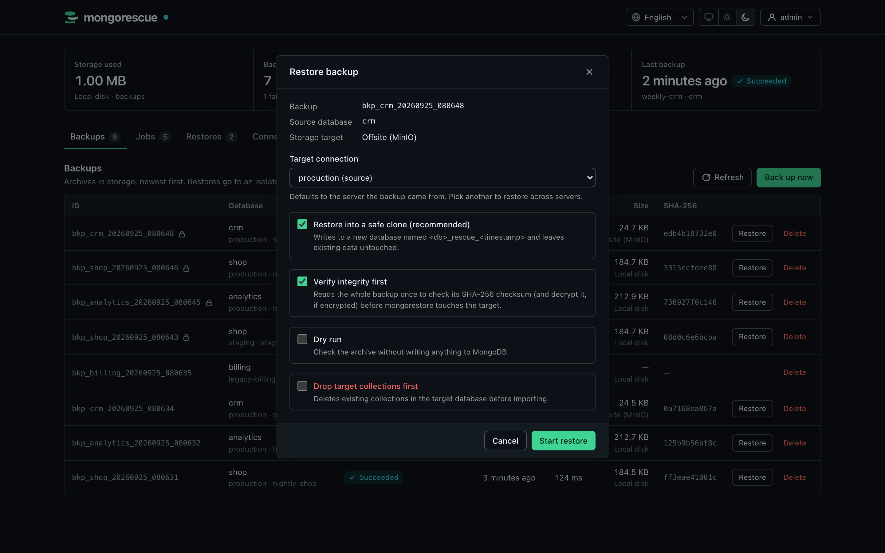
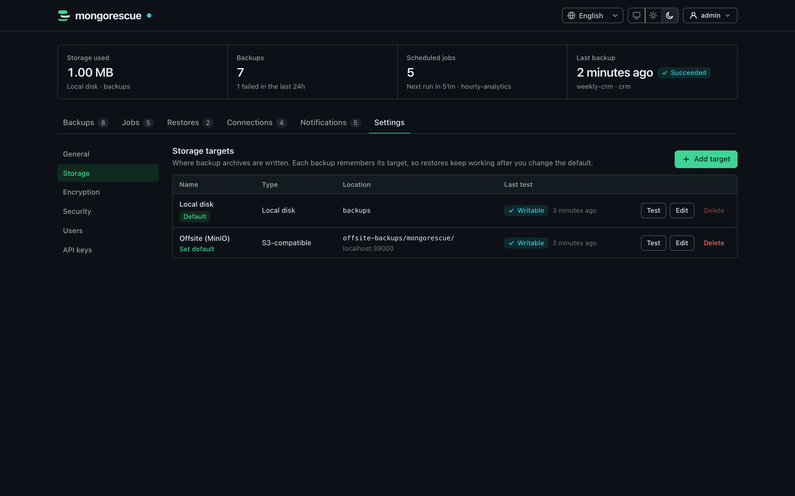
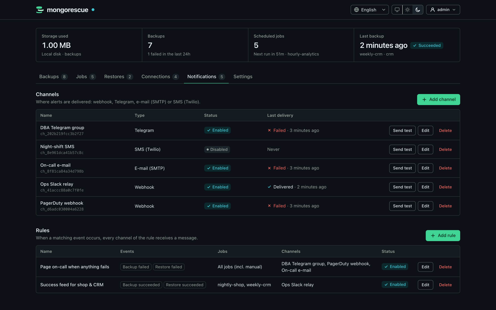
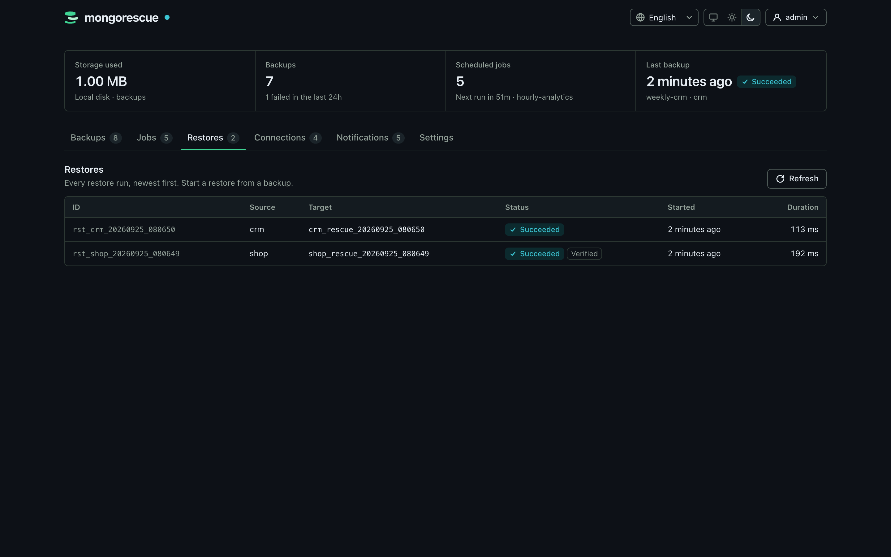
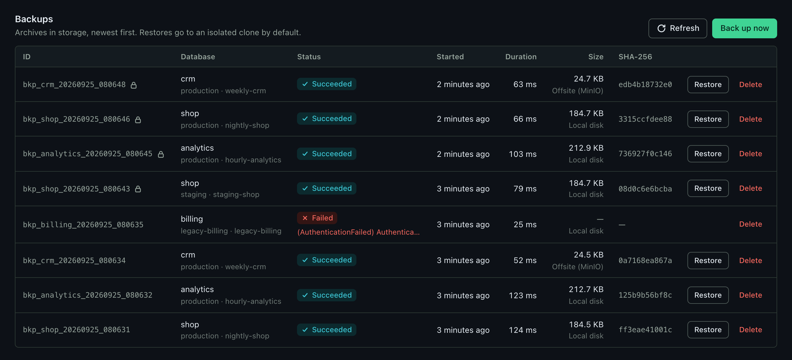
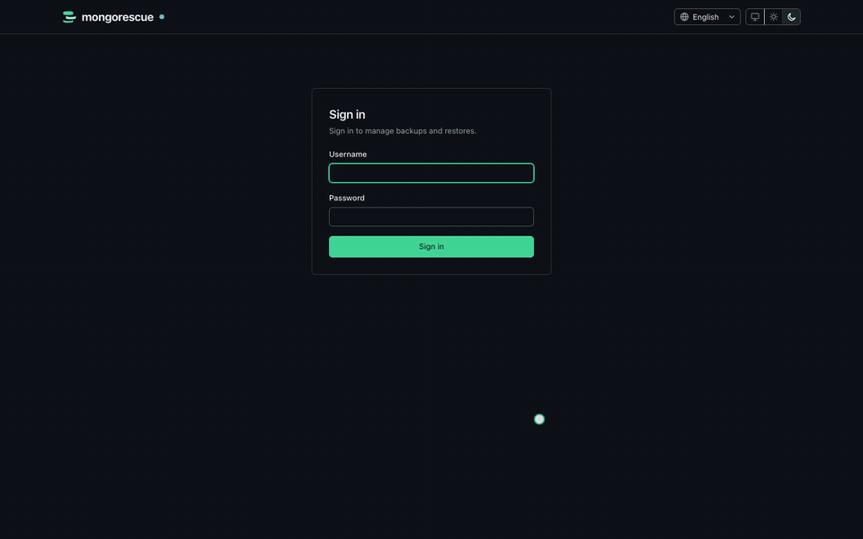

# MongoRescue

<p align="center">
  
</p>

<p align="center">
  <strong>MongoDB backups and restores that stream, verify and encrypt.</strong><br>
  A single Go binary with a built-in web dashboard, Point-in-Time Recovery (PITR), and disaster recovery.
</p>

<p align="center">
  <a href="https://github.com/YigitCittan/mongorescue/actions/workflows/ci.yml"></a>
  <a href="https://github.com/YigitCittan/mongorescue/releases"></a>
  <a href="https://github.com/YigitCittan/mongorescue/blob/main/LICENSE"></a>
  <a href="https://scorecard.dev/viewer/?uri=github.com/YigitCittan/mongorescue"></a>
</p>

---


??? info "More screenshots"
    | | |
    | --- | --- |
    |  |  |
    | First-run setup | MongoDB connections |
    |  |  |
    | Scheduled jobs | Restore into a safe clone |
    |  |  |
    | Storage targets | Notifications |
    |  |  |
    | Restore history | Backups |

MongoRescue runs `mongodump` on a schedule, streams the archive to local disk or any S3-compatible bucket, and brings it back with `mongorestore` when you need it. The dump is piped straight through, so memory use stays flat no matter how large the database is.

Restores go into a separate copy of the database (`<db>_rescue_<timestamp>_<id>`) unless you explicitly ask to overwrite the original. Nothing touches production by accident.

---

## Key Features

* **Multi-Database & Multi-Server Management:** Manage multiple MongoDB servers from one instance. Test connections, preview databases, filter collections, and restore into separate clusters.
* **Point-in-Time Recovery (PITR):** Continuously capture MongoDB oplog slices and restore your replica sets to any exact millisecond in the past.
* **True Streaming Architecture:** Backups and restores stream directly via Unix pipes — no huge local temporary files or RAM spikes.
* **Automated Verification & Restore Testing:** Every backup is checksummed on upload, periodically swept at rest, and test-restored to temporary databases to ensure provable recovery.
* **Built-in S3 Object Lock & Compliance:** S3 immutability prevents any archive deletion or modification before retention expires, even by compromised admin credentials.
* **Client-Side Age Encryption:** Encrypt backups with modern `age` encryption before transmission so your cloud storage provider only holds ciphertext.
* **Safe-Clone Restores by Default:** Restores never overwrite production data unless explicitly confirmed with forced override.
* **Modern Web Dashboard & Native Desktop App:** Real-time progress, dark/light themes, keyboard navigation (`Ctrl+K`), and native Windows/macOS/Linux desktop bundles.
* **Enterprise SSO & Audit Logging:** OpenID Connect (OIDC) integration, role-based access control (RBAC), and tamper-evident hash-chained audit trails.
* **AI Ready (Model Context Protocol):** Built-in MCP server allows AI coding and DevOps assistants to query backup health and safely trigger operations.

---

## Quick Start with Docker

The fastest way to get started is using the official Docker container:

```bash
docker run -d --name mongorescue -p 8080:8080 \
  -v mongorescue-data:/data -v mongorescue-backups:/backups \
  ghcr.io/yigitcittan/mongorescue:latest
```

1. Open `http://localhost:8080` in your browser.
2. Enter the one-time setup code printed in the logs (`docker logs mongorescue`).
3. Create your administrator account, connect your MongoDB database, and schedule your first backup!

<p align="center">
  
</p>

For Docker Compose, Kubernetes Helm charts, or standalone binary setups, check the [Configuration Guide](configuration.md) and [Kubernetes Deployment](kubernetes.md).
