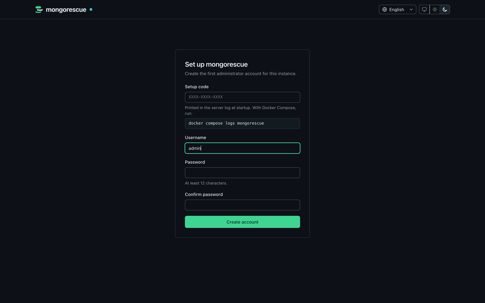
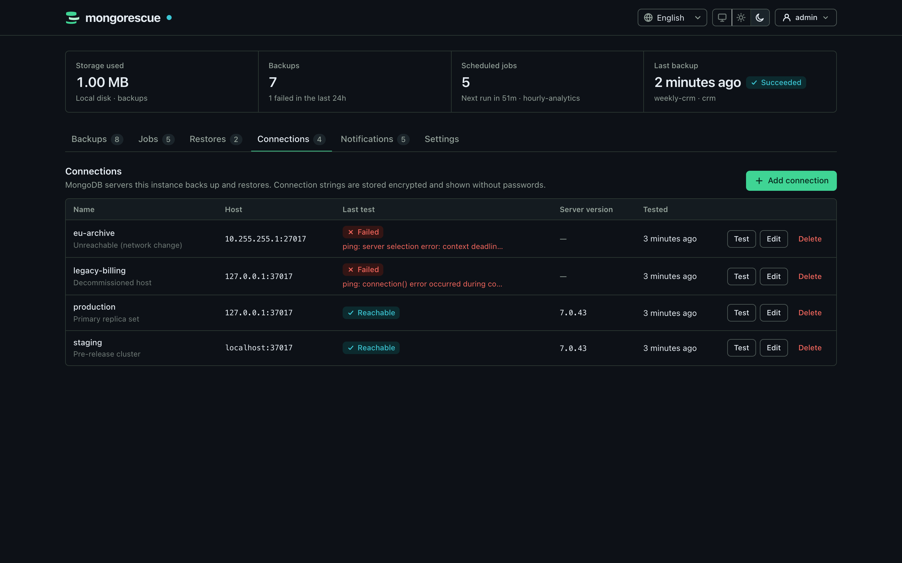
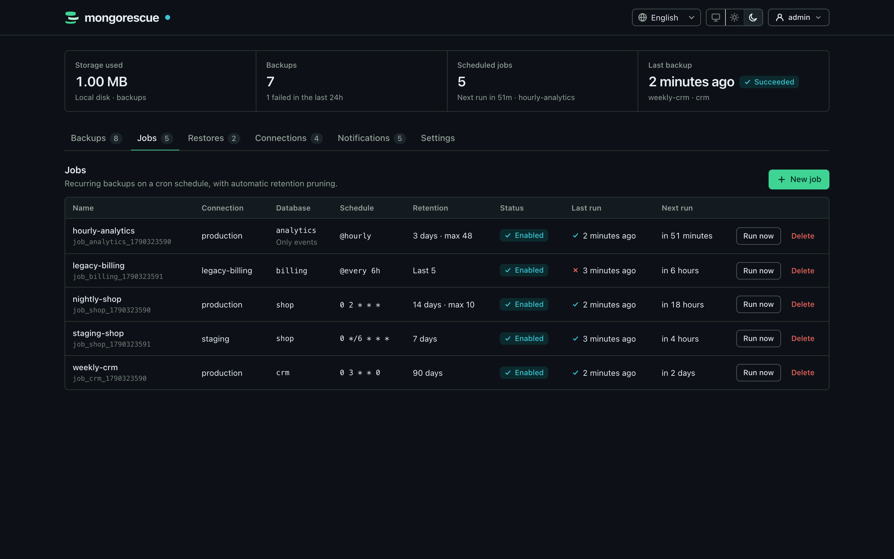
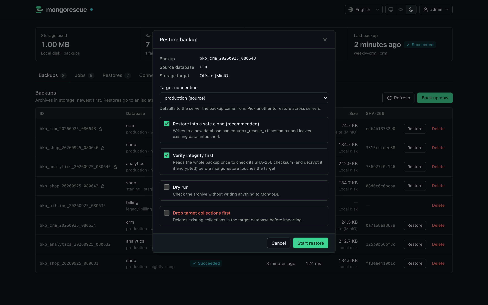
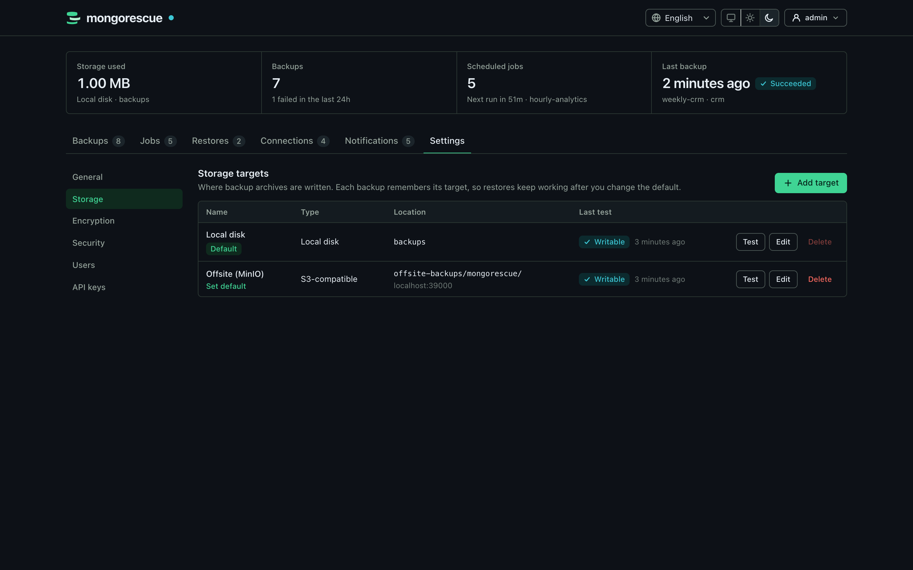
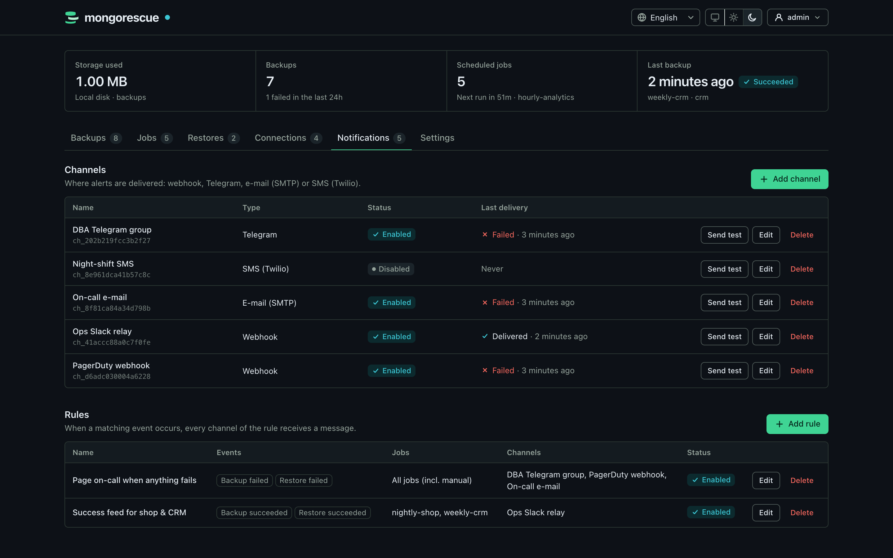
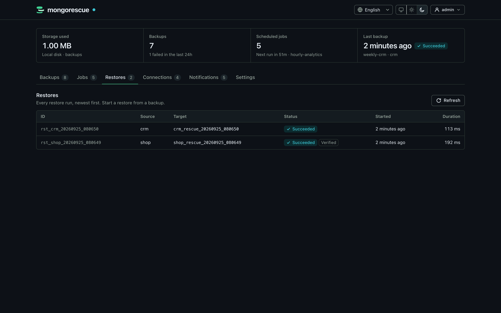
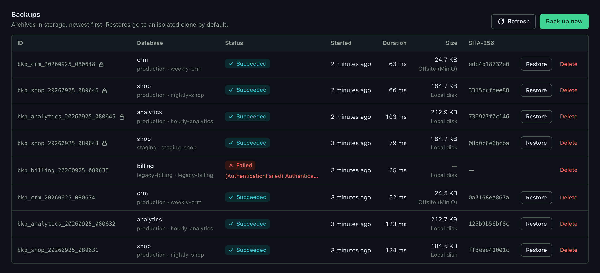
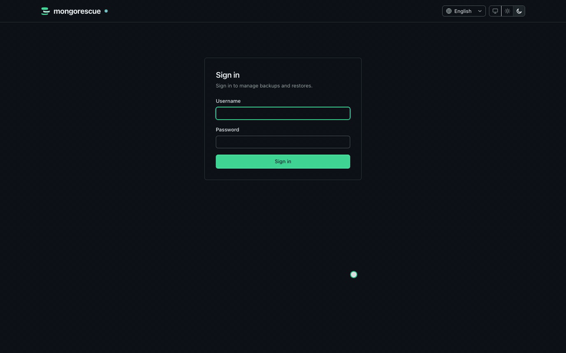

# MongoRescue

<p align="center">
  
</p>

<p align="center">
  <strong>MongoDB backups and restores that stream, verify and encrypt.</strong><br>
  A single Go binary with a built-in web dashboard, Point-in-Time Recovery (PITR), and disaster recovery.
</p>

<p align="center">
  <a href="https://github.com/YigitCittan/mongorescue/actions/workflows/ci.yml"></a>
  <a href="https://github.com/YigitCittan/mongorescue/releases"></a>
  <a href="https://github.com/YigitCittan/mongorescue/blob/main/LICENSE"></a>
  <a href="https://scorecard.dev/viewer/?uri=github.com/YigitCittan/mongorescue"></a>
</p>

---


??? info "More screenshots"
    | | |
    | --- | --- |
    |  |  |
    | First-run setup | MongoDB connections |
    |  |  |
    | Scheduled jobs | Restore into a safe clone |
    |  |  |
    | Storage targets | Notifications |
    |  |  |
    | Restore history | Backups |

MongoRescue runs `mongodump` on a schedule, streams the archive to local disk or any S3-compatible bucket, and brings it back with `mongorestore` when you need it. The dump is piped straight through, so memory use stays flat no matter how large the database is.

Restores go into a separate copy of the database (`<db>_rescue_<timestamp>_<id>`) unless you explicitly ask to overwrite the original. Nothing touches production by accident.

---

## Key Features

MongoRescue streams verified, optionally age-encrypted logical backups of standalone servers and replica sets (MongoDB 5.0 to 8.0) to local disk or S3, restores into a safe clone by default and adds point-in-time recovery, S3 Object Lock, SSO, an audit log and an MCP server.

See the [full feature catalogue](features.md), and [how MongoRescue compares](comparison.md) with mongodump + cron, Percona Backup for MongoDB, Atlas Backup, Ops Manager and restic/Velero, including who it is not for (sharded clusters are not supported yet).

---

## Quick Start with Docker

The fastest way to get started is using the official Docker container:

```bash
docker run -d --name mongorescue -p 8080:8080 \
  -v mongorescue-data:/data -v mongorescue-backups:/backups \
  ghcr.io/yigitcittan/mongorescue:latest
```

1. Open `http://localhost:8080` in your browser.
2. Enter the one-time setup code printed in the logs (`docker logs mongorescue`).
3. Create your administrator account, connect your MongoDB database, and schedule your first backup!

<p align="center">
  
</p>

Prefer a terminal, or running the binary on Linux or Windows? The [five-minute CLI walkthrough](getting-started-cli.md) takes you from nothing to a verified backup and a restore into a safe clone, with Linux, Windows (PowerShell) and Docker variants side by side. For Docker Compose, Kubernetes or standalone binary setups, see the [deployment recipes](deployment-recipes.md), the [Configuration Guide](configuration.md) and [Kubernetes Deployment](kubernetes.md).

---

## Find your way

Every page of this site, grouped by what you are trying to do. The search box (top right) covers all of them; unfamiliar words are in the [glossary](glossary.md), common questions in the [FAQ](faq.md).

### Start

Understand what it is and get a first backup.

- [Why MongoRescue](comparison.md): how it compares with `mongodump` + cron, Percona Backup for MongoDB, Atlas Backup, Ops Manager and restic/Velero, and who it is not for
- [Feature catalogue](features.md): everything it does, in one list
- [First backup from the CLI](getting-started-cli.md): five minutes, Linux, Windows and Docker
- [MongoDB connections](connections.md): TLS, x509, LDAP, Kerberos, Atlas, AWS IAM, Vault, privileges
- [Desktop application](desktop.md): Windows, macOS and Linux, with the tools bundled
- [Kubernetes and Helm](kubernetes.md): the chart, the secret key, ingress, upgrades
- [Deployment recipes](deployment-recipes.md): Caddy with HTTPS, a Kubernetes CronJob, GitHub Actions

### Operate

Run it, watch it, recover with it.

- [Production checklist](production.md): TLS, authentication, the data directory, sizing, high availability, systemd and Compose
- [Upgrading and rolling back](upgrading.md)
- [Point-in-time recovery](pitr.md): continuous oplog collection and restores to the second
- [Verification, restore tests and retention](verification.md)
- [Monitoring and heartbeat](monitoring.md), [notifications and alerts](notifications.md)
- [Storage usage and cost](cost.md): stored size per target over time, an estimated monthly cost from your prices, egress
- [Incident runbooks](runbooks.md): one page per alert, [troubleshooting](troubleshooting.md)

### Secure

Protect the backups and the tool that holds them.

- [Delete protection, Object Lock and key wrapping](security.md)
- [Threat model (STRIDE)](threat-model.md)
- [Age encryption](encryption.md) and key rotation
- [Single sign-on (OIDC)](sso.md)
- [Audit logging](audit.md)
- [Privacy, retention and erasure requests](privacy.md)

### Integrate

Drive it from scripts, CI and assistants.

- [Command line](cli.md): `backup`, `restore`, `list`, `verify`, `status`, exit codes, CI examples
- [REST API](api.md) and its [OpenAPI description](openapi.md)
- [MCP server](mcp.md) for AI assistants

### Reference

Look something up.

- [Configuration](configuration.md): bootstrap flags, settings, storage and environment variables
- [Prometheus metrics](metrics.md)
- [FAQ](faq.md) and [glossary](glossary.md)
- [Versioning policy](versioning.md) and the [roadmap](roadmap.md)

### Design

How it is built and why.

- [Architecture overview](architecture.md)
- [High availability (active-passive)](design/ha.md), [PITR storage and codec](design/pitr.md), [roles and permissions](design/roles.md), [OIDC architecture](design/oidc.md)
- [Testing strategy](testing.md)

Contributing, the changelog and the source are in the [repository](https://github.com/YigitCittan/mongorescue).
